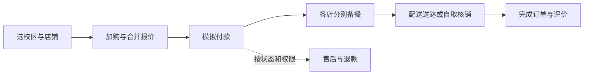
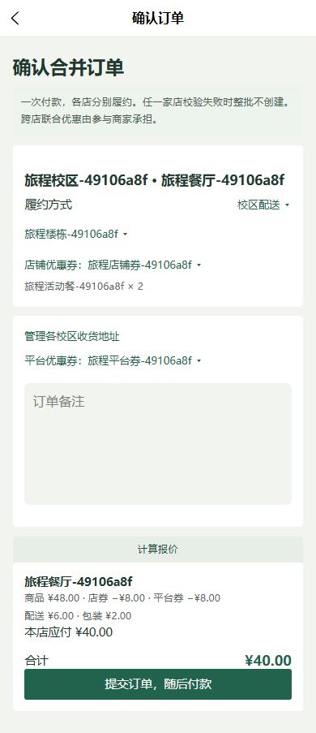
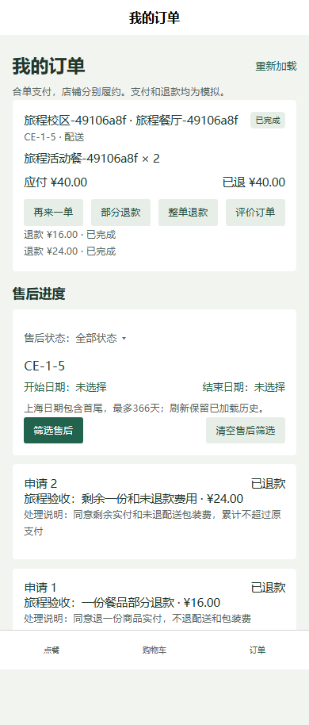
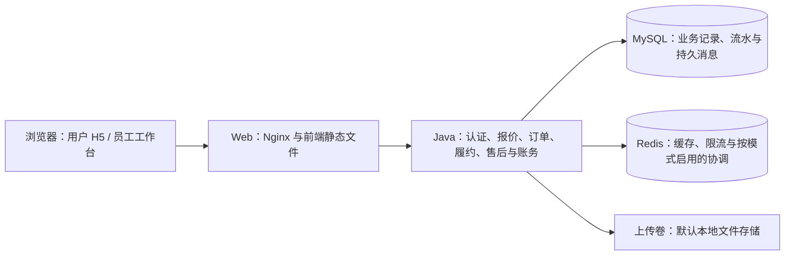

# CampusEats · 校园多校区点餐平台

[](https://github.com/W205614/CampusEats/actions/workflows/verify.yml)
[](https://github.com/W205614/CampusEats/releases/latest)
[](LICENSE)

CampusEats 面向校园点餐与食堂店铺管理：学生可以跨店选餐、合并报价和付款，各店分别备餐，再按订单选择校园配送或到店自取；员工在各自权限内处理履约、售后和经营核对。

它解决的是多店重复下单、优惠与费用难以核对、履约和售后分散的问题。当前定位为个人开发、学习和本机演示，默认监听回环地址，付款与退款使用模拟渠道。微信、腾讯云和多实例适配已有代码，真实商户、云端生产和小程序真机仍需单独验收。

推荐稳定版为 **[v1.0.4](https://github.com/W205614/CampusEats/releases/tag/v1.0.4)**。Java/Web 的公开 Docker/OCI 镜像来自源码 [`b88b67a`](https://github.com/W205614/CampusEats/commit/b88b67ae074fb2cb27decebde03a1eeaff9a6d5e) 的同次成功 CI，已实际匿名拉取并运行。`master` 可包含后续文档更新；镜像来源按 Release 与摘要核对。

## 可以完成什么

| 使用者 | 操作与结果 |
| --- | --- |
| 点餐用户 | 选校区和店铺、加购、领取优惠、合并报价；核对各店费用后模拟付款，查看履约与退款进度、提交评价 |
| 店长与运营 | 维护商品、配额、营业状态和优惠；按店接单、备餐、安排配送或核销自取码，处理售后与经营报表 |
| 配送员 | 在所属校区领取或接受任务，完成取餐与送达；订单字段和后续访问随权限及履约状态收敛 |
| 平台管理员 | 管理校区、店铺、员工和独立体验账号，处理履约异常、售后介入、审计及模拟账务核对 |

商家独立收款，平台不抽佣；跨店联合优惠由参与商家承担。默认演示中的金额流转不发生真实扣款，规则见[平台架构](docs/platform-architecture.md)。



## 真实界面

以下画面来自 **v1.0.4 公开镜像的隔离业务验收**，使用合成校区、店铺、优惠和订单，支付与退款均为模拟。左图为优惠后报价，右图为履约完成及两次退款的结果。当前没有在线演示站点。

<p>
  
  
</p>

本轮镜像实际通过选餐、配送、分次退款、平台介入和评价的页面旅程，见[验证记录](docs/verification/current.md)。

## 选择启动方式

命令在项目根目录的 **PowerShell 7** 中执行；Windows 与 Linux 都使用 `pwsh`，无需切换 Bash 环境变量语法。先取得稳定版的 Compose、配置示例和脚本：

```powershell
git clone --depth 1 --branch v1.0.4 https://github.com/W205614/CampusEats.git
cd CampusEats
```

`v1.0.4` 是固定版本；需要开发中源码时再选择 `master`，不能把开发分支当成已发布镜像来源。各路线选择其一，已有数据环境先读[升级与恢复](docs/platform-deployment.md)，不要重建空库替代升级。

| 路线 | 适合谁 | 宿主依赖与入口 |
| --- | --- | --- |
| **预构建应用镜像** | 直接体验已发布应用 | Git、PowerShell、Docker 与 Compose；Java/Web 拉取，MySQL/Redis 按项目配方本地构建；端口 `28104` |
| **源码 Docker 构建** | 修改应用并构建自己的镜像 | 同上，Java/Maven/Node 在构建容器内；默认端口 `18083` |
| **宿主源码开发** | Java 断点、前端热更新 | Java 21、Maven、Node.js `24.19.0`；Docker 提供独立 MySQL/Redis；Java `18084`、员工端 `5173/admin/`、H5 `5174/app/` |

### 拉取预构建应用镜像

先按[镜像首次部署步骤](docs/platform-deployment.md#ghcr-start)生成随机凭据及 `.local/ghcr-demo/demo.env`，其中指定本版本应用的不可变摘要。完成配置后：

```powershell
$composeArgs = @('compose', '--env-file', '.local/ghcr-demo/demo.env', '-p', 'campuseats-ghcr-demo')
docker @composeArgs build --pull mysql redis
docker @composeArgs pull server web
docker @composeArgs up -d --no-build --wait --wait-timeout 300
```

访问[用户端](http://127.0.0.1:28104/)和[员工工作台](http://127.0.0.1:28104/admin/)。拉取只是准备步骤，四服务启动后，Java 通过 Flyway 初始化数据库和演示资料。

| 项目发布的应用镜像 | 已验证平台与职责 |
| --- | --- |
| `ghcr.io/w205614/campuseats-server:v1.0.4` | `linux/amd64`，Java 服务 |
| `ghcr.io/w205614/campuseats-web:v1.0.4` | `linux/amd64`，Nginx、员工工作台与用户 H5 |

两者已公开，精确摘要见 [Release 验证附件](https://github.com/W205614/CampusEats/releases/download/v1.0.4/campuseats-v1.0.4-verification.json)，历史见 [Packages](https://github.com/W205614/CampusEats/packages)。MySQL 8.4.13 和 Redis 7.4.12 是必需依赖，使用项目固定且带补丁的 Dockerfile，本项目不向 GHCR 重新发布它们。依赖构建仍需 Docker、Alpine、Oracle 的网络下载，两个应用镜像不能替代完整部署。

### 从源码构建 Docker 镜像

在全新源码目录中执行：

```powershell
pwsh -NoProfile -File ./scripts/start.ps1 -SkipVerify
$composeArgs = @('compose')
```

脚本生成随机凭据、`.env` 和 `.local/demo-credentials.txt`，构建并启动四服务。`-SkipVerify` 只跳过宿主 Maven 验证；这是**本地源码构建**。已有 CI 制品环境使用[制品升级流程](docs/platform-deployment.md#已采用-ci-制品的日常环境)。

访问[用户端](http://127.0.0.1:18083/)和[员工工作台](http://127.0.0.1:18083/admin/)。首次构建需访问基础镜像、Maven、npm 与 Oracle 补丁来源，宿主无需 Java 或 Node。

### 在宿主运行源码

按[宿主 Java 与独立数据库步骤](docs/development.md#host-source)准备依赖、变量、本地构建并启动 Java，再按[前端热更新](docs/development.md#frontend-dev)启动两端。Maven 只用于源码构建和开发进程，不提供 Maven 应用包下载或运行入口。

微信小程序另行构建并导入微信开发者工具，见[小程序开发](docs/development.md#微信小程序)。服务端镜像不能替代客户端平台验收，编译通过不代表真机登录、支付和订阅消息已验证。

### 状态、日志与暂停

以下用于两条 Docker 应用路线。保留其 `$composeArgs`，新开终端先恢复对应配置与项目名；宿主开发进程按开发指南在原终端停止：

```powershell
docker @composeArgs ps
docker @composeArgs logs --tail 100 server web
docker @composeArgs stop --timeout 60
```

首次部署应看到 `mysql`、`redis`、`server`、`web` 全部健康。停止保留数据；删除持久卷可能丢失数据库、Redis 或上传内容。日常启停见[维护指南](docs/operations.md#日常启停与排障)。

## 登录并完成第一笔订单

以下为全新数据库的演示模式，访问地址取决于所选路线。

1. 使用平台账号 `admin` 登录员工工作台。镜像路线的初始密码在受保护配置的 `DEMO_ADMIN_PASSWORD` 中；源码启动脚本另生成 `.local/demo-credentials.txt`。已有账号不会因改环境变量自动重置密码。
2. 在「校区与店铺」找到「默认店铺」，进入「营业配置」，确认营业时段，开启「接收新订单」并保存。新店默认关闭接单。
3. 用户端点击「登录点餐」，选择演示用户，在「默认校区 → 默认店铺」加购，进入购物车，点击「选择此店」和「合并结算」。
4. 选择「到店自取」，计算报价、提交订单，再点击「整批模拟支付」。体验配送时先添加该店所在校区的地址。
5. 工作台退出 `admin`，以店长 `manager1` 登录并按提示改密，完成「接单备餐」「备餐完成」，用用户订单页的自取码核销，查看完成结果。

平台也可创建独立体验账号，用户选择「独立账号登录」。更多角色与试用模式见[演示账号说明](docs/operations.md#演示账号)。

## 架构与源码入口

本机演示由四服务组成：



后端为 Java 21 / Spring Boot 4.1，数据层为 MySQL 8.4 / Redis 7.4。员工端使用 Vue 3、Pinia、Element Plus 和 Vite；用户端由 uni-app 构建 H5 与微信小程序。WebSocket 提供实时提示，持久消息及权限判断由后端和数据库负责，详见[平台架构](docs/platform-architecture.md)。

| 目录 | 职责与阅读入口 |
| --- | --- |
| `campuseats-server/` | Spring 应用，从 [HTTP 入口](campuseats-server/src/main/java/com/campuseats/web/)沿服务追踪；[Flyway 迁移](campuseats-server/src/main/resources/db/migration/)维护数据库演进 |
| `campuseats-api/`、`campuseats-common/` | Java 请求/响应类型、共享异常与摘要工具 |
| `frontend/admin/`、`frontend/client/` | 员工工作台和用户端；[开发指南](docs/development.md#按业务追踪请求)提供业务调用链 |
| `frontend/contracts/` | OpenAPI 快照、生成类型和前端共享模型；生成文件按脚本维护 |
| `deploy/`、`scripts/` | [容器配置](deploy/README.md)、[构建/发布/备份工具](scripts/README.md) |
| `.github/workflows/` | 构建、浏览器回归、镜像扫描、CodeQL 与手动镜像推广 |

## 环境、配置与外部服务

本轮验证包括 Windows / PowerShell **7.6.9** / Docker Desktop WSL2（Compose **5.6.1**）的本机运行，以及 Ubuntu 24.04 CI 的源码构建、测试和 `linux/amd64` 容器。宿主 Java 开发使用 Java 21、Maven 3.9.9，前端使用 Node.js 24.19.0。macOS、ARM64 和其他工具版本未逐项验证，不承诺多架构镜像。

必要变量见 [.env.example](.env.example)，以下五项均需独立随机生成，不能保留占位符：

| 变量 | 用途 | 默认处理 |
| --- | --- | --- |
| `MYSQL_ROOT_PASSWORD` | 数据库管理与恢复 | 源码启动脚本生成随机值；镜像路线显式生成 |
| `MYSQL_PASSWORD` | 应用访问 MySQL | 同上，不与 root 口令共用 |
| `REDIS_PASSWORD` | Redis 认证 | 同上，独立值 |
| `JWT_ADMIN_SECRET` | 签名与认证相关用途 | 同上，生成 32 随机字节，保密保存 |
| `DEMO_ADMIN_PASSWORD` | 首次初始化演示员工 | 同上；已有账号保持原密码 |

演示默认 `APP_MODE=demo`、`MOCK_PAYMENT_ENABLED=true`、`BIND_ADDRESS=127.0.0.1`。宿主 Java 不自动读取 Compose 的 `.env`，按[开发步骤](docs/development.md#host-source)设置数据库、Redis 与上传目录等变量。

微信付款退款、微信身份、腾讯云短信/COS 和订阅消息均为**可选外部接入**。默认缺少真实账号、授权、密钥、模板和资源，这些真实渠道不可用，模拟点餐可独立运行。接入可能产生服务费用，按[生产接入](docs/production-readiness.md)、[身份与通知](docs/identity-notifications.md)、[文件存储](docs/storage-integration.md)准备并真实验收。CLB/CVM、托管数据库和生产多实例方案是模板及接入指导，不能据此认定已生产部署。

## 验证、排错与数据维护

v1.0.4 的 master / Tag CI 各通过后端 **360** 项、浏览器 **95** 项，失败、错误和跳过均为 0。它们包括单元、Docker 集成、真实页面和隔离传输边界测试；真实微信、云服务和小程序真机没有因此获得验收。CodeQL、Dependabot、秘密扫描的当前未解决告警为 0，保留 **9 条已审阅的原始 CodeQL 发现**，见[安全审阅边界](docs/security-review.md)和[本轮证据](docs/verification/current.md)。

常用源码检查从根目录执行，按改动选择范围；Java 集成测试需要 Docker，写入式浏览器测试使用独立数据库：

```powershell
mvn -B -ntp clean verify
npm run test:toolchain --prefix frontend/admin
npm run build --prefix frontend/admin
npm run test:toolchain --prefix frontend/client
npm run typecheck --prefix frontend/client
npm run build:h5 --prefix frontend/client
npm run build:mp-weixin --prefix frontend/client
```

CI、浏览器凭据与隔离测试步骤见[贡献指南](CONTRIBUTING.md)。本轮没有生产容量认证，历史合成负载测量只适用于当时版本、环境和方法。

| 现象 | 先检查 |
| --- | --- |
| 启动失败、端口冲突 | 所选端口是否占用、Docker 是否运行 Linux 容器、Compose 是否读取正确环境文件 |
| 数据库或服务不健康 | 用上面的状态/日志命令定位；检查口令与旧卷是否匹配，不删除卷来绕过错误 |
| 镜像拉取失败 | GHCR 网络、完整仓库名、版本与 `amd64` 平台；MySQL/Redis 依赖是否已构建 |
| 能登录但不能下单 | 店铺是否营业接单、配额/地址/校区是否匹配，是否完成报价与模拟付款 |
| 开发 API 失败 | `API_PROXY`、允许的 Origin、宿主数据库映射是否一致，前端是否误连日常后端 |

MySQL、Redis 和上传分别持久化到 Compose 的 `mysql-data`、`redis-data`、`uploads` 命名卷。备份需包含数据库、上传与匹配配置，并独立验证恢复；升级保留原卷和已执行迁移，v1.0.4 仍为 **V24**。详细[备份、升级与恢复](docs/platform-deployment.md)和[日常排障](docs/operations.md)集中维护，不把核验元数据当作完整恢复负载。

## 版本、参与与许可

[Tags](https://github.com/W205614/CampusEats/tags)、[Releases](https://github.com/W205614/CampusEats/releases)和[变更记录](CHANGELOG.md)用于核对正常历史版本；应用 GHCR 分发从 v1.0.3 开始。源码、镜像摘要、对应源码材料与本轮验收在 [v1.0.4 Release](https://github.com/W205614/CampusEats/releases/tag/v1.0.4)对应，应用 Package 明确采用容器镜像。

使用问题与脱敏缺陷通过 [Issues](https://github.com/W205614/CampusEats/issues)反馈，修改按[贡献指南](CONTRIBUTING.md)提交 Pull Request；安全问题按[安全政策](SECURITY.md)报告。更多主题见[文档目录](docs/README.md)。

项目自有源码、文档与素材采用 [MIT License](LICENSE)。第三方代码、基础镜像和制品分别适用其许可证；通知、SBOM 和对应源码获取见[许可说明](docs/licensing.md)。
