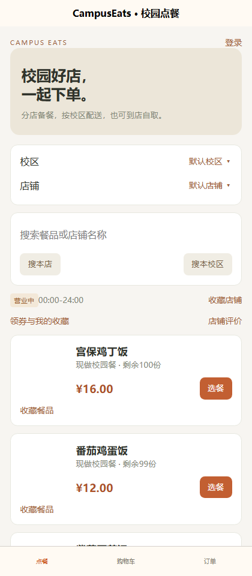
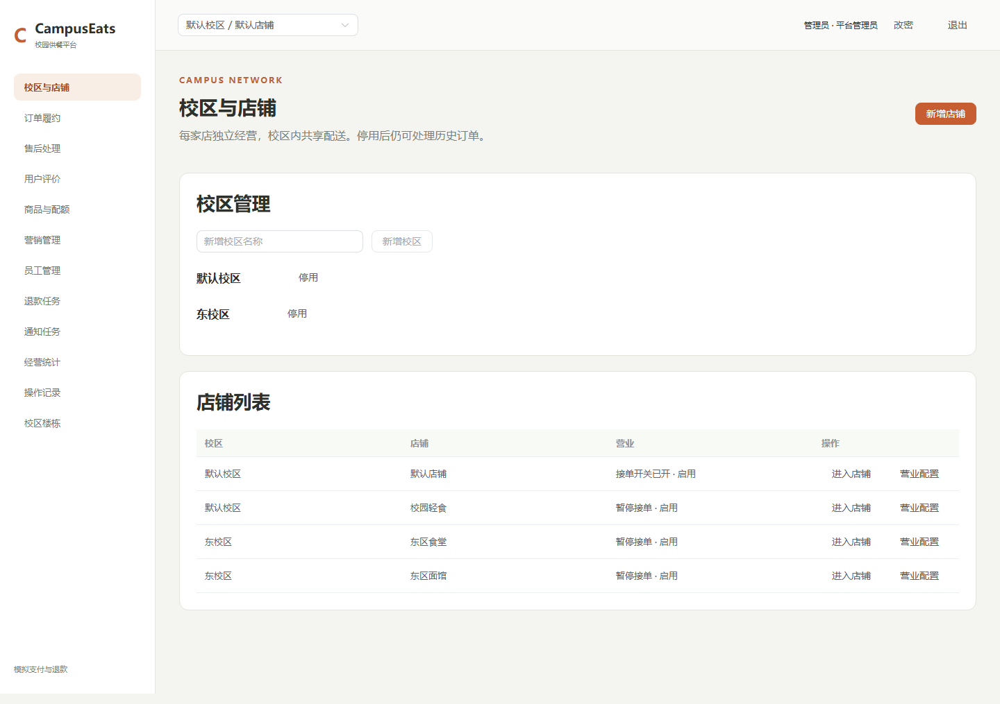
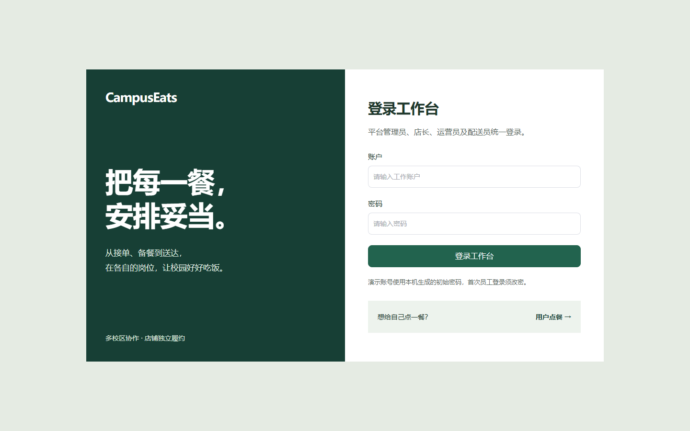

# CampusEats · 校园多校区点餐平台

CampusEats 面向校园内多家餐饮店，提供用户点餐、商家接单、校区配送与售后管理。用户可以跨店、跨校区合并结算，各店独立备餐，按店选择配送或到店自取。

基于 **Spring Boot + Vue 3 + uni-app + MySQL + Redis**，采用单体、单实例后端，通过 Docker Compose 启动 MySQL、Redis、Java 后端和 Nginx 四个服务。

> 默认提供演示登录、模拟支付和模拟退款，不发生真实资金交易。适合本地体验和学习；微信小程序登录需要另行配置，尚未完成微信真机验收。不包含真实商户资金清算、自动路线规划或第三方配送。

本项目定位为个人可维护的单机、单实例演示应用，默认只监听本机。演示编号由访问者共享，请勿填写真实姓名、电话或地址；模拟支付成功不能作为真实收款凭证。外部身份核验、公网 HTTPS、高可用、异机灾备及常驻运维调度不属于已交付能力。

项目提供平台创建的独立测试账号：首次登录须改密，支持停用、密码重置和旧会话撤销。履约时限与异常工作台、配送交接、可离线补读的站内消息，以及模拟流水、日结和对账均已部署。支付、退款交互保持原有模拟方式。

项目已进入功能冻结与按需维护阶段。源码最新迁移为V19，针对历史数据增长后的对账读取复用一次余额聚合，并增加订单与流水覆盖索引；权限、库存、退款和对账口径保持不变。正式发布使用通过完整CI的制品，源码版本、实际部署制品及本机收尾状态分别以[当前版本验证与维护记录](docs/verification/current.md)列明的证据为准。

本机日常项目按用户要求仅保留当前镜像、业务卷、上传文件及必要配置，不长期保留完整数据备份和离线镜像恢复包。发布校验产生的临时恢复材料在部署验证后人工清理，历史恢复清单不代表仍有可用恢复集。隔离容量测试及收尾材料的实际状态见当前版本记录。

目录按个人演示规模设限：每店最多500个菜品和套餐（包含停售项），每个菜品最多20组口味，套餐最多50项组成。创建时按店串行校验，已有数据不删除；历史超限目录会明确提示维护，不静默截断。私有举证经鉴权后以固定缓冲传输，默认全局4、每账号2个并发读取，每账号每分钟120次。限流同时经过有容量上限的本地闸门，Redis缓存淘汰不会重置本进程的请求预算。

## 功能与解决的问题

| 场景 | 提供的功能 |
|---|---|
| 校区和店铺分散，管理范围容易混淆 | 统一管理多个校区与店铺，店长、运营员按店授权，配送员按校区处理任务 |
| 一次想买多家店的餐品 | 搜索校区、店铺与餐品，独立店铺购物车，跨校区合并结算，各店分别履约 |
| 点餐后需要配送或自取 | 商家接单、备餐、派单，校区配送员抢单、取餐与送达，到店自取码核销 |
| 需要营销和日常经营工具 | 菜品与套餐、口味、每日配额、营业时间、活动价、店铺券、平台券和经营统计 |
| 订单出现问题，需要后续处理 | 取消订单、催单、图片举证、部分或整单退款、平台介入，以及收藏和评价 |
| 历史售后和异常任务不容易找到 | 用户售后、商家与平台的售后／退款／通知支持状态、日期、订单号筛选和加载更早记录；任务支持精确编号查询 |
| 店铺或校区搜索超过一页 | 用户端与工作台支持游标分页和加载更多；搜索结果可直接进入尚未加载的店铺 |
| 多个体验者需要独立账号 | 平台创建测试用户，首次改密，停用与重置后旧会话失效；本机试用模式关闭共享演示入口 |
| 订单久未推进或配送员离岗 | 分阶段服务时限、异常确认、停止接新单、未完成任务交接与紧急停用；超时不自动取消或退款 |
| 离线时错过订单变化 | 账号独立的站内消息、未读数、已读与离线补读，WebSocket用于提示刷新 |
| 模拟金额需要逐笔核对 | 事务内收支流水、历史期初快照、冻结日结及对账差异；没有真实付款或商户清算 |

跨校区合单时，各店的配送地址仍须属于该店所在校区；合并付款后，各店独立处理订单。

## 效果图

以下为本地演示环境截图。

**用户点餐端：选择校区与店铺、浏览餐品**



**平台工作台：管理校区与独立店铺**



**员工登录与用户点餐入口**



## 快速部署

以下步骤用于**首次本地演示部署**。已有业务数据的环境，请先阅读[升级与回滚说明](docs/platform-deployment.md)。

### 1. 准备环境

- 安装 Git、PowerShell 7（命令为 `pwsh`）。Windows 自带的 Windows PowerShell 5.1 不适用于此启动脚本。
- 安装并启动 Docker Desktop，使用 **Linux 容器模式**，确保可用 `docker compose`。
- 首次构建需要联网下载基础镜像和依赖。下面的方式在 Docker 内构建应用，无需本机安装 Java、Maven 或 Node.js。

### 2. 下载并启动

打开 PowerShell 7 终端，依次执行：

```powershell
git clone https://github.com/W205614/CampusEats.git
cd CampusEats
pwsh -NoProfile -File ./scripts/start.ps1 -SkipVerify
```

脚本自动生成本机 `.env` 和随机初始密码，从源码构建镜像、初始化数据库与演示数据，并等待服务就绪。`-SkipVerify` 跳过本机 Maven 后端验证；省略该参数需另装 Java 21 和 Maven。

启动结束后查看服务状态与初始密码：

```powershell
docker compose ps
Get-Content .local/demo-credentials.txt
```

四个服务均应显示 `healthy`。初始密码文件仅在本机保存，不要上传或分享。

### 3. 打开页面并登录

| 入口 | 地址 | 登录方式 |
|---|---|---|
| 用户点餐 | [http://localhost:18083/](http://localhost:18083/) | 点击「登录点餐」，选择一个演示用户，无需密码 |
| 平台／商家／配送工作台 | [http://localhost:18083/admin/](http://localhost:18083/admin/) | 使用下表账号，初始密码见 `.local/demo-credentials.txt` |

全新数据库会初始化两个校区、每校区两家店及以下员工账号：

| 角色 | 账号 |
|---|---|
| 平台管理员 | `admin` |
| 店长 | `manager1` ～ `manager4` |
| 店铺运营员 | `operator1` ～ `operator4` |
| 校区配送员 | `courier1`、`courier1b`、`courier2`、`courier2b` |

新建的店长、运营员和配送员共用文件中的初始密码，首次登录必须改密。已有账号保留原密码，修改 `.env` 或重新生成密码文件不会重置账号。

### 4. 体验第一笔订单

1. 先用 `admin` 登录工作台，在「校区与店铺」找到「默认店铺」，打开「营业配置」，确认营业时段，开启「接收新订单」并保存。全新数据库的店铺默认关闭接单。
2. 在用户端登录演示用户，选择「默认校区 → 默认店铺」，选餐加购；进入购物车，点击「选择此店」后「合并结算」。
3. 首次可选择「到店自取」，点击「计算报价」，提交订单后在订单页完成「整批模拟支付」。如选择配送，先添加与店铺同校区的收货地址。
4. 在工作台退出 `admin`，改用默认店铺的店长 `manager1` 登录并完成首次改密；进入「订单履约」，完成「接单备餐」和「备餐完成」。自取订单使用用户订单页的核销码完成核销；配送订单可派单或由本校区配送员抢单，再完成取餐、送达。

也可以用 `admin` 在工作台查看校区、店铺和员工归属。用户端与员工端会话独立，可在同一浏览器切换体验。三个演示用户各自隔离数据，但同一演示用户编号由所有访问者共用。

需要独立体验时，用平台账号进入「用户账号」创建测试用户，交付初始密码；用户在点餐端选择「独立账号登录」，首次改密后重新登录。忘记密码由平台重置，不提供开放注册或短信找回。

`.env` 中 `APP_MODE=demo` 保留演示入口；改为 `trial` 可在本机试用独立账号，关闭共享演示登录。空试用库只引导一个需要首次改密的平台账号，已有库不重置账号。默认仍绑定 `127.0.0.1`，两种模式都使用模拟资金。

## 常见问题与日常使用

| 遇到的问题 | 处理方式 |
|---|---|
| 找不到 `pwsh`，或脚本运行报版本相关错误 | 安装 PowerShell 7，使用上面的 `pwsh -NoProfile -File ...` 命令启动 |
| Docker 连接失败或构建下载失败 | 确认 Docker Desktop 已启动且处于 Linux 容器模式，并检查镜像源与依赖下载的网络连接 |
| `18083` 端口被占用 | 修改 `.env` 的 `WEB_PORT`，同步修改 `ALLOWED_ORIGINS` 中两个地址的端口，再运行启动命令；之后使用新端口访问 |
| 店铺休息中，无法下单 | 在工作台检查对应店铺的接单开关、营业时段和商品配额；新增店铺默认关闭接单 |
| 手机打不开页面 | 默认只监听本机 `127.0.0.1`，请先用部署电脑的浏览器体验 |
| 启动失败或页面无法访问 | 在项目根目录查看 `docker compose ps` 和下方日志，定位未就绪的服务 |

以下命令均在项目根目录执行：

```powershell
# 查看最近的日志
docker compose logs --tail=100 server web

# 暂停服务，保留数据
docker compose stop

# 再次启动已有服务
docker compose up -d --wait --wait-timeout 300
```

数据库、Redis 和上传文件使用 Docker 持久卷保存。不要使用 `docker compose down -v` 停止日常环境，该命令会删除数据卷。

## 稳定性与验证

员工、券模板、钱包、活动及收藏提供完整分页，默认50条、最多200条；旧数组接口保留形状但最多返回200条，已标记弃用，内置页面改用分页。筛选和账号切换重置游标，失败保留当前结果。配送员仅在履约期间获取必要联系方式，终态隐藏电话和详细地址，配送消息不包含售后退款信息。

每店服务时限默认是接单10、备餐30、待分配15、待取餐15、配送60、自取120分钟；阶段开始后保存快照，修改策略仅影响后续阶段。异常工作台用于确认和人工处置，不绕过原有状态、版本或退款约束。

模拟流水与支付、退款成功在同一事务落账。升级只保存历史期初，不伪造旧流水；日结按上海自然日冻结已结束日期，当日仅预览，后续退款计入发生日。手续费和佣金为零，负净额标记待抵扣，平台对账发现差异时只报告。

报价和提交统一使用上海业务时间，跨日后的旧报价要求重新确认；结果不明时仍按原请求找回订单。跨店搜索先筛选商品，再批量补充库存和活动，避免逐店读取整份菜单。

历史列表约每15秒更新全部已加载记录，按最多1000条批量读取；界面仍以100条加载历史，保留原有筛选和手动刷新方式。例如单个列表加载10页后的刷新只需1次请求，11页需2次；这减少请求和重复查询，不减少需要展示的数据量。切换账号或店铺、离开页面后，旧请求不会覆盖当前记录。

商品图片和售后举证共用进程内空间账本，计入公开图片、私有举证及临时文件。首次使用、距上次校准60秒后的首次上传，以及接近上限或文件操作异常时会扫描校准；每次上传和发布仍检查磁盘剩余空间。适用于单实例管理上传卷，恢复或手工修改文件需停写；不会安装后台定时任务。原图片大小、尺寸、并发、数量及空间限制保留。

运维工具支持项目互斥、独立恢复后的备份副本，以及异常变化／恢复通知；只交付配置入口，不自动安装定时任务或接入外部服务。配置步骤见[日常维护](docs/operations.md#可配置的一次性运维入口)。运行环境以固定摘要的Temurin 21.0.13 Alpine、Nginx 1.30.6 Alpine slim、MySQL 8.4.13和Redis 7.4.12为基础；MySQL补充经官方哈希和签名校验的curl/libcurl补丁，并纳入同次CI制品。CI检查四服务镜像的系统包及实际Java运行依赖，发现任何已知漏洞均会阻断，包括中低危和未提供修复版本的条目；通过仅代表本次扫描覆盖范围内未检出已知漏洞。

本地验证只覆盖本次改动直接影响的模块或流程，完整回归、恢复与安全门禁以最终提交的 GitHub Actions 为准。当前版本记录区分源码测试与日常部署核验；短时本机验证不代表生产峰值容量、长期可靠性或高可用。

## 项目结构与阅读入口

```text
CampusEats/
├─ README.md              首次部署与第一笔订单
├─ pom.xml                Maven 多模块入口
├─ sky-common/            公共业务异常、摘要工具
├─ sky-pojo/              请求与响应契约
├─ sky-server/            Spring Boot 后端、数据库迁移与测试
├─ frontend/
│  ├─ admin/              平台、商家、配送工作台（Vue 3）
│  ├─ client/             用户端（uni-app，H5／微信小程序）
│  └─ contracts/          共享类型与 OpenAPI 契约
├─ compose.yaml          本地四服务编排
├─ Dockerfile            后端源码镜像
├─ deploy/               Nginx、Web 镜像、Maven 配置与运维模板
├─ scripts/              启动、构建、验证和备份工具
├─ docs/                 现行指南、当前版本验证与演示截图
└─ .github/workflows/     GitHub Actions 验证流程
```

首次只需按本文完成部署；阅读源码时按[开发与源码阅读指南](docs/development.md)跟踪一笔订单。`.env` 和 `.local/` 是受 Git 忽略的本机配置、凭据及备份，不属于共享源码。

根目录保留 Maven、Docker、编辑器和 Git 默认发现的配置与启动入口；部署配置统一放在 `deploy/`，Vite、TypeScript、应用配置继续由各模块维护。具体职责见[部署配置导航](deploy/README.md)，无需为集中存放而改变默认命令。

本机验证和交付材料集中在 `.local/verification/`，按交付范围命名子目录，实际保留位置见[当前版本记录](docs/verification/current.md)。本机完整备份和离线镜像恢复包已按用户要求停用，`.local/backups/LATEST.json` 和 `LATEST.txt` 是禁用标记，不提供恢复能力。发布校验产生的临时材料在验证后移入回收站，多余镜像按明确ID清理；源码、业务卷、上传文件、必要配置及当前镜像保留。

- [文档导航](docs/README.md)：按体验、开发、维护和查证据选择入口。
- [架构与接口](docs/platform-architecture.md)：权限范围、合单交易与履约规则。
- [日常维护](docs/operations.md)：运维检查、安全备份、资源保护和运行边界。
- [升级与回滚](docs/platform-deployment.md)：已有数据环境的升级与恢复。
- [当前版本验证与维护记录](docs/verification/current.md)：当前源码、部署及整理的证据与限制。
