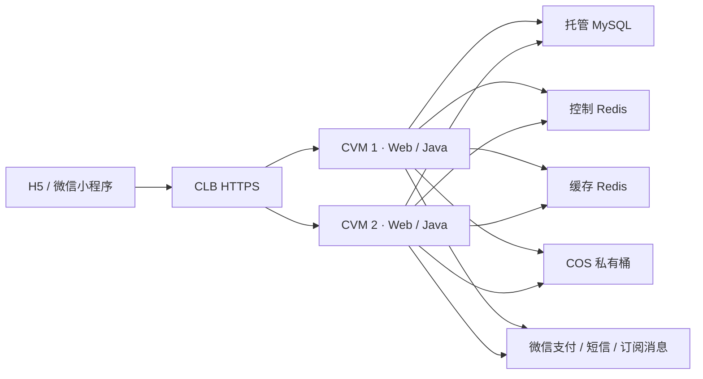
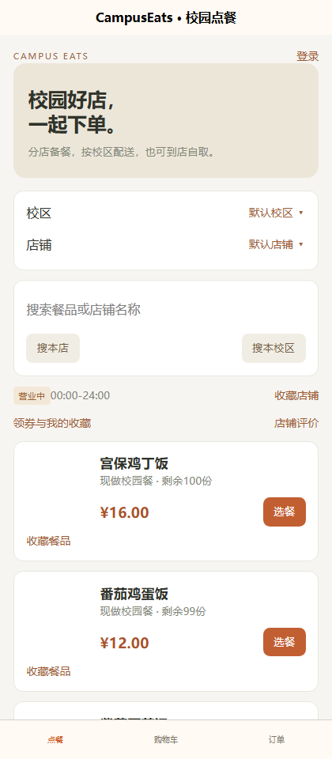
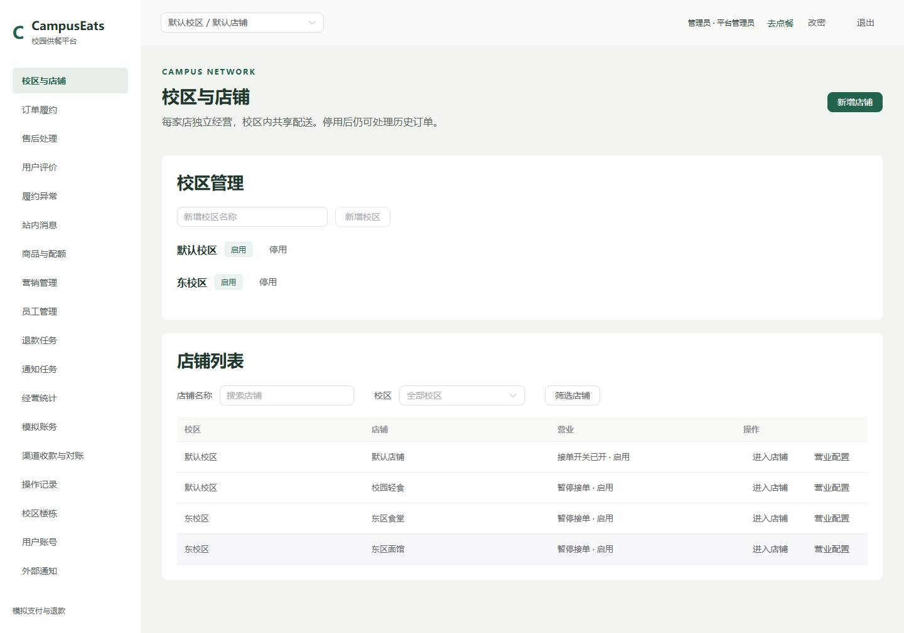
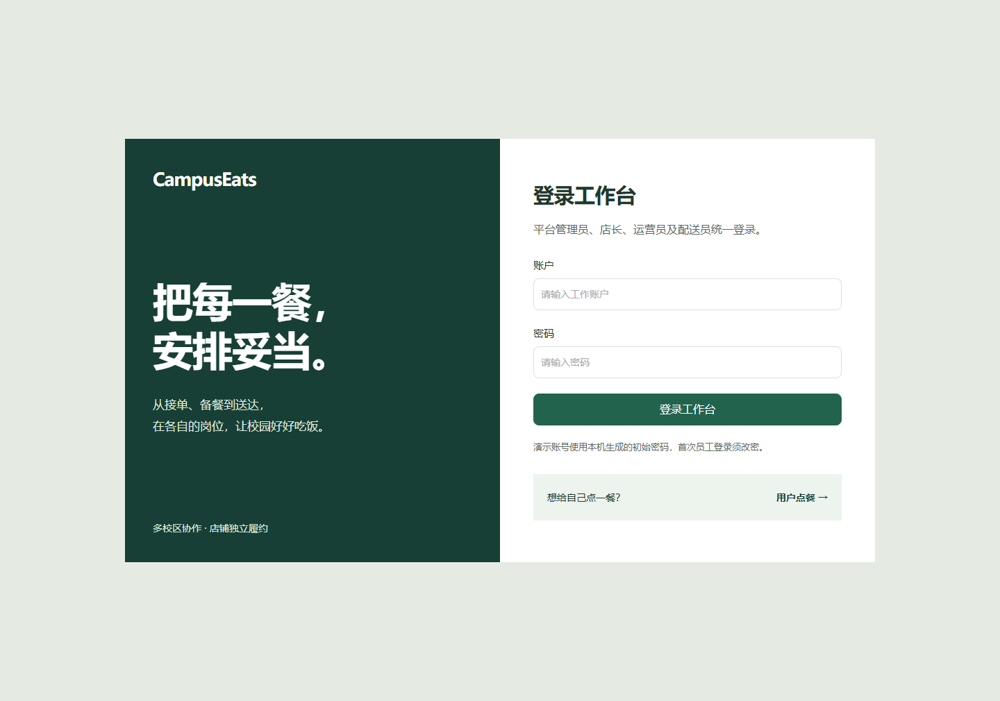

# CampusEats · 校园多校区点餐平台

[](https://github.com/W205614/CampusEats/actions/workflows/verify.yml)

CampusEats 让学生在多个校区、多个店铺选餐后合并付款，各店分别备餐，支持配送和到店自取。员工工作台按角色处理店铺营业、订单履约、售后和经营报表。

默认启动的是本机演示环境，监听 `127.0.0.1`，付款与退款使用模拟渠道，共享演示账号使用虚构资料。后端使用 Java 21、Spring Boot 4.1、MySQL 8.4 和 Redis 7.4，员工工作台使用 Vue 3，用户端使用 uni-app。

## 当前状态与维护方式

本地点餐、合单、履约、售后、权限和账务流程已完成回归，适合个人开发、学习和演示使用。当前阶段按需维护：遇到可复现问题、需要升级依赖或调整业务时再修改，暂不继续扩展功能。

微信支付、腾讯云短信与 COS、微信订阅消息及多实例部署已有接入实现，默认关闭。需要使用时，按下文完成外部账号、商户授权、资源配置和真实业务验收。日常启停见[日常维护](docs/operations.md#日常启停与排障)，源码、CI 和部署结果见[当前版本记录](docs/verification/current.md)。

## 生产接入

生产模式为单体多实例：CLB HTTPS → 两台 CVM 的 Web/Java → 托管 MySQL、控制 Redis、缓存 Redis、COS。商家绑定自己的微信子商户，平台不抽佣；跨店联合优惠由参与商家承担。平台配置店铺与子商户，微信外部进件和产品授权在微信后台完成。

| 能力           | 实现与后续接入                                                                                                         |
| -------------- | ---------------------------------------------------------------------------------------------------------------------- |
| 微信收款/退款  | 已实现四种支付场景、验签解密、查单关单、退款结果确认；填写服务商、公钥、私钥、AppID、回调域名并为店铺绑定已授权子商户  |
| 手机与微信身份 | 已实现验证码登录、应用身份绑定、授权、资料与注销；填写腾讯云短信模板、小程序与公众号配置、运营方隐私政策               |
| 站外通知       | 已实现短信投递与回执、微信订阅授权与投递；填写事件模板与字段映射，启用选定事件                                         |
| COS 文件       | 已实现私有桶读写适配、固定商品入口、鉴权举证、元数据与上传结果未知核验；创建两个开启版本控制的私有桶并配置最小权限凭据 |
| 多实例与运维   | 已实现共享目录版本、实时广播、数据库任务租约；提供生产配置检查、滚动发布说明、监控告警与恢复流程                       |

按[生产接入总览](docs/production-readiness.md)准备参数，再按[腾讯云部署与运维](docs/production-deployment.md)部署。详细步骤、模板、接口和故障处理见[身份与通知](docs/identity-notifications.md)、[文件存储](docs/storage-integration.md)。后续对这些已实现服务的接入以配置和外部授权为主；新增支付产品、其他服务商或新业务规则仍需相应开发。

接入和部署状态按[当前版本记录](docs/verification/current.md)核对；早期验证过程保留在[候选留档](docs/verification/production-upgrade.md)。



本地验证环境为 Windows、PowerShell 7、Docker Desktop/WSL2，镜像面向 `linux/amd64`；生产模板面向 Linux CVM。小程序编译与真机验收分别记录。其他宿主平台与架构需要另行验证，构建条件见[开发指南](docs/development.md)。

## 首次启动

准备 Git、PowerShell 7（命令为 `pwsh`）以及已启动的 Docker Desktop，选择 Linux 容器模式。当前构建面向 `linux/amd64`。首次构建需能下载基础镜像、Maven 与 npm 依赖以及 Oracle 安全补丁。Java 和前端应用均在 Docker 中构建。

在 PowerShell 7 中执行：

```powershell
git clone https://github.com/W205614/CampusEats.git
cd CampusEats
pwsh -NoProfile -File ./scripts/start.ps1 -SkipVerify
docker compose ps
```

看到 `mysql`、`redis`、`server`、`web` 四个服务均为 `healthy` 即可登录。启动脚本生成本机 `.env` 并初始化演示数据，`-SkipVerify` 跳过本机 Maven 验证。已有容器的日常启停见[日常维护](docs/operations.md#日常启停与排障)，已有数据库或 CI 制品环境请先阅读[升级与回滚](docs/platform-deployment.md)。

## 登录并完成第一笔订单

在仓库根目录运行 `Get-Content .local/demo-credentials.txt`，查看脚本生成的初始密码，凭据仅供本机使用。以下步骤使用全新数据库的默认演示模式。

1. 打开[员工工作台](http://localhost:18083/admin/)，使用平台账号 `admin` 登录。在「校区与店铺」找到「默认店铺」，进入「营业配置」，确认当前处于营业时段，开启「接收新订单」并保存。新店默认关闭接单。
2. 打开[用户点餐端](http://localhost:18083/)，点击「登录点餐」并选择一个演示用户。在「默认校区 → 默认店铺」加购餐品，进入购物车，点击「选择此店」和「合并结算」。
3. 选择「到店自取」，点击「计算报价」，提交订单，再到订单页点击「整批模拟支付」。如体验配送，先添加该店所在校区的地址。
4. 回到工作台，退出 `admin`，使用默认店铺的店长 `manager1` 登录并按提示改密。在「订单履约」依次完成「接单备餐」「备餐完成」，用用户订单页显示的自取码核销。此时可在订单页看到已完成的订单。

需要独立体验账号时，可由平台管理员在「用户账号」中创建，用户在点餐端选择「独立账号登录」。其他角色和试用模式见[演示账号说明](docs/operations.md#演示账号)。

## 目录与源码入口

| 想做什么                   | 从哪里开始                                                                                                                                                                                                                  |
| -------------------------- | --------------------------------------------------------------------------------------------------------------------------------------------------------------------------------------------------------------------------- |
| 改管理台页面               | [员工工作台页面](frontend/admin/src/pages/)按业务命名，[路由](frontend/admin/src/router.ts)定义访问入口                                                                                                                     |
| 改用户点餐流程             | [用户端页面](frontend/client/src/pages/)包含选店、购物车、结算和订单，[页面配置](frontend/client/src/pages.json)列出导航顺序                                                                                                |
| 查订单如何报价、支付和履约 | `campuseats-server/` 是后端主模块，从[HTTP 入口](campuseats-server/src/main/java/com/campuseats/web/)沿服务方法追踪，见[四条业务调用链](docs/development.md#按业务追踪请求)                                                                      |
| 找数据库变更               | [Flyway 迁移](campuseats-server/src/main/resources/db/migration/)按版本保存数据库演进记录                                                                                                                                          |
| 查接口契约                 | [共享契约](frontend/contracts/)包含 OpenAPI 快照、生成类型和前端共享模型；[Java 接口类型](campuseats-api/src/main/java/com/campuseats/api/)包含请求与响应定义                                                                            |
| 找构建与部署入口           | [根 POM](pom.xml)聚合后端服务、接口类型和[共享异常与哈希工具](campuseats-common/src/main/java/com/campuseats/common/)；[Compose](compose.yaml)编排四个服务，[部署配置](deploy/README.md)和[脚本导航](scripts/README.md)列出构建与运维入口 |
| 查提交会运行哪些验证       | [GitHub Actions 工作流](.github/workflows/)定义 CI 的构建、测试、安全扫描与制品导出                                                                                                                                         |

## 界面预览

**用户点餐 · 选店、浏览餐品与加购**



**员工工作台 · 校区与店铺管理**



**员工登录入口**



## 专题文档

| 主题                           | 阅读入口                                         |
| ------------------------------ | ------------------------------------------------ |
| 架构、权限和交易规则           | [多校区平台架构](docs/platform-architecture.md)  |
| 本地开发、前端联调和微信小程序 | [开发与源码阅读](docs/development.md)            |
| 日常启停、排障和维护           | [日常维护](docs/operations.md)                   |
| 维护已有环境、升级和回滚       | [部署与恢复](docs/platform-deployment.md)        |
| 源码、CI、容量测量与部署版本   | [当前版本验证记录](docs/verification/current.md) |
| 版本变化与升级影响             | [变更记录](CHANGELOG.md)                         |
| 开发协作、验证与提交规则       | [贡献指南](CONTRIBUTING.md)                      |
| 安全支持与漏洞私报             | [安全政策](SECURITY.md)                          |
| 其他指南                       | [文档目录](docs/README.md)                       |

## 支持与许可

使用问题和经过脱敏的缺陷通过 [GitHub Issues](https://github.com/W205614/CampusEats/issues)反馈，附上版本、复现步骤和预期结果。安全漏洞及敏感材料通过[私有报告渠道](SECURITY.md)提交。

项目自有源码、文档与素材以 [MIT License](LICENSE) 发布。第三方组件保留各自许可；依赖清单、构建产物中的版权说明与分发要求见[许可说明](docs/licensing.md)。
